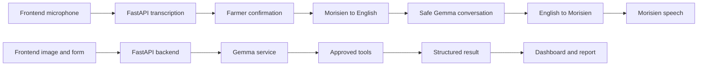

# Proposed architecture

The language path below is implemented for local integration. Crop analysis,
approved tool calling, frontend wiring, and public deployment remain in
progress.

## Proposed boundaries

- The voice path is turn-by-turn rather than continuous streaming.
- The frontend must show the draft transcript for farmer confirmation.
- The backend retains only a short memory-only text history, not uploaded audio.
- The image and structured-report path remains proposed until the team approves
  its tool and safety contracts.
- The dashboard and report views will consume the shared data contract.

The team must still confirm tool permissions, deployment resources, and the
shared crop-report data contract before completing dependent implementation.
