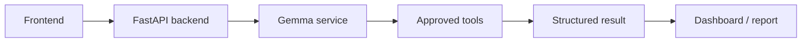

# Proposed architecture

This architecture is a coordination proposal only. None of these components or connections has been implemented.

## Proposed boundaries

- The frontend will collect inputs and render agreed structured results.
- The FastAPI backend will validate requests and coordinate services.
- The Gemma service will isolate model integration and structured-response handling.
- Approved tools will be explicitly selected and controlled by the backend team.
- The dashboard and report views will consume the shared data contract.

The team must confirm the architecture, official Gemma integration method, tool permissions, and shared data contract before writing dependent implementation code.
